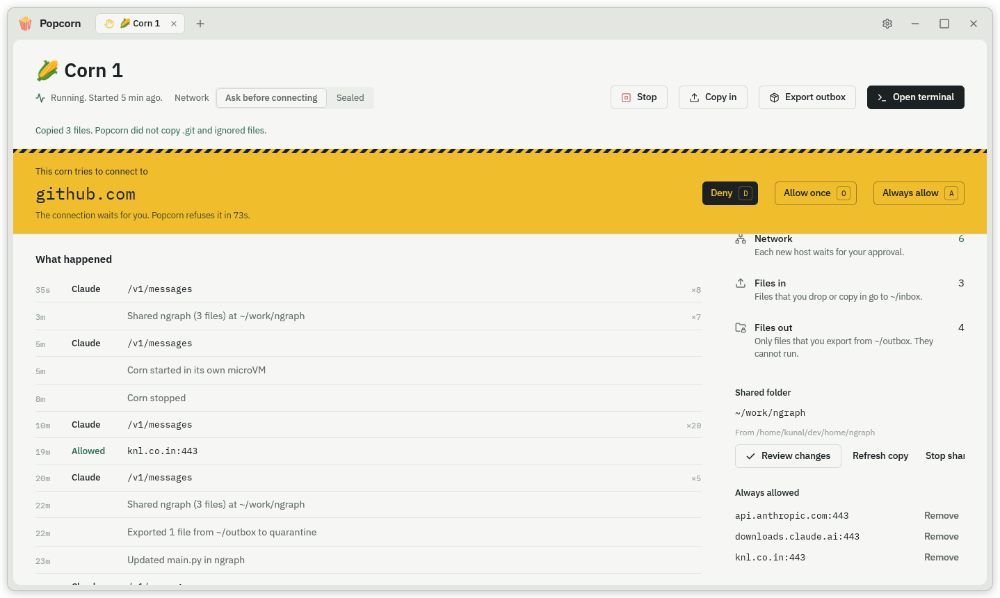
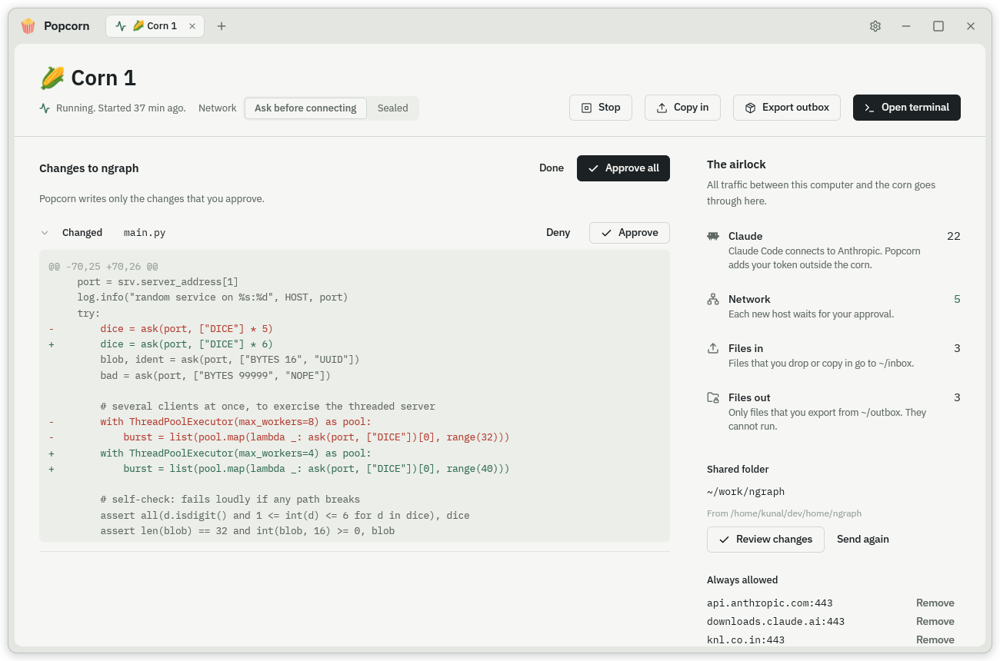
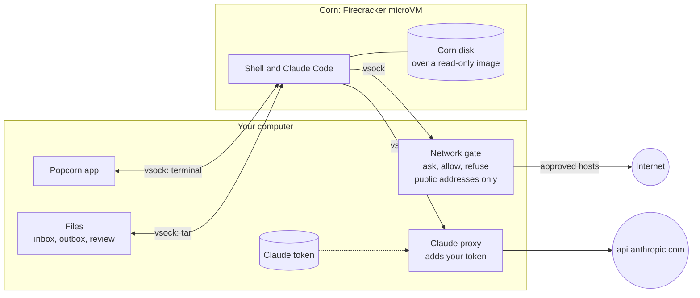

<p align="center">
  
</p>

<h1 align="center">Popcorn</h1>

<p align="center">
  A workbench for risky work.<br>
  Each job runs in a <b>corn</b>: a small virtual machine that cannot touch your computer.
</p>

<p align="center">
  <a href="https://github.com/KunalSin9h/popcorn/releases/latest"></a>
</p>

---

## What it does

Open untrusted code, suspicious packages and unknown binaries in a corn. You and Claude Code
work inside it. Your files, Claude token, keys and network stay outside.

🌽 A corn is a [Firecracker](https://firecracker-microvm.github.io/) microVM with its own Linux
kernel. It boots in about one second.

<p align="center">
  
</p>



- **Terminal:** a shell in the corn.
- **Network:** you deny, allow once or always allow each new host. Always allow applies to every corn.
- **Files in:** drop or pick files. They land in `~/inbox`.
- **Files out:** export from `~/outbox` as copies that cannot run.
- **Shared folder:** the corn works on a copy, sent with git. Ignored files stay home, so large projects work. You approve each change before Popcorn writes it back.

<br clear="right">

## How it keeps you safe

| Guarantee | How |
|---|---|
| Own kernel | Each corn is a separate VM. A kernel exploit stays inside. |
| Second wall | Firecracker runs inside bubblewrap. It sees only its disk, image and kernel, with no network, no home folder and no other processes. |
| No network card | The corn talks only to Popcorn, over a private channel. |
| You approve each new host | Popcorn holds the connection and asks. No answer in 90 seconds means no. |
| No access to your network | Popcorn refuses loopback, private and link-local addresses, even for allowed hosts. It connects only to addresses it checked. |
| Claude token stays outside | Claude Code in the corn gets a fake token. Popcorn adds the real one to requests to `api.anthropic.com`. |
| No access to your files | Popcorn mounts no host folder. The corn has its own system and disk. |
| Files leave only on export | Exports are plain copies. |
| Clipboard stays yours | The terminal drops clipboard escapes (OSC 52) from the corn, so code in a corn cannot set or read your clipboard. |
| Folder changes need approval | Popcorn writes only the files you approve, and only inside that folder. It never writes links, `.git` or executable files. |
| Changes are checked | The corn's changes arrive as a git bundle. Popcorn checks each object, keeps them in a separate repository, and never runs their hooks, filters or checkout. |
| Keys stay outside | Popcorn refuses to share your home folder or any folder with `.ssh`, `.gnupg`, `.aws` or `.config`. It skips `.git` and ignored files, and the folders of Mercurial, Subversion and other version control systems. |

### Limits

- A hypervisor escape is rare but possible. Firecracker then still runs inside bubblewrap, as your user. Popcorn does not use the jailer, which needs root.
- An allowed host can receive data from the corn.
- The terminal shows output from the corn. A bug in your terminal app is outside Popcorn.
- Keep your kernel and Firecracker up to date.

## Architecture



## Quick start

<a href="https://github.com/KunalSin9h/popcorn/releases/latest"></a>

You need Linux with KVM. [docs/DEV.md](docs/DEV.md) lists the system packages.

```sh
./scripts/fetch-firecracker.sh   # Firecracker and a guest kernel, one time
./scripts/build-image.sh         # the workbench image, with Docker, one time
cargo run --release
```

On first run, Popcorn asks for your name, the image and an optional Claude token. Get a token
with `claude setup-token`.

## Documentation

- [docs/DEV.md](docs/DEV.md): stack, build, tests and workflow.

## License

[PolyForm Noncommercial 1.0.0](LICENSE.md). Read the code, build it, and use it for personal
testing, hobby work or study, free.
