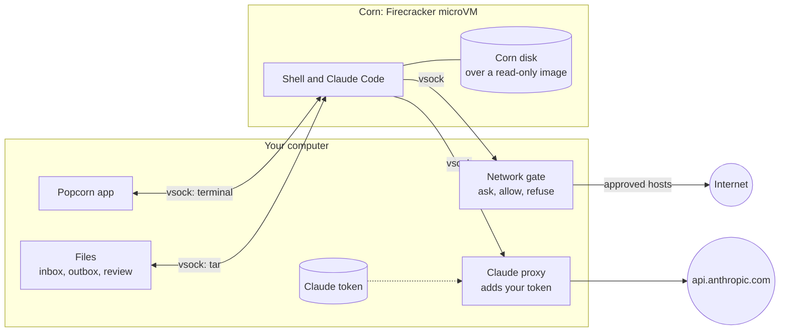
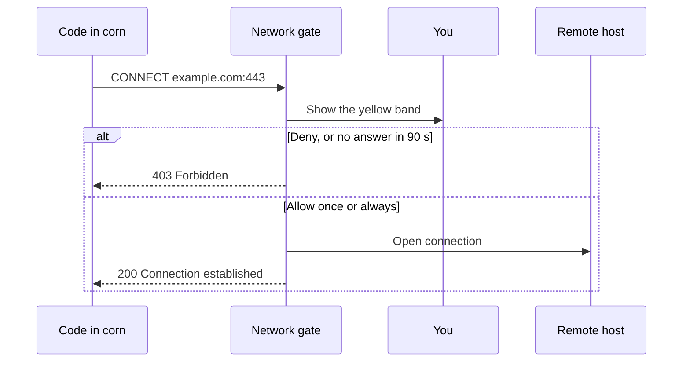

<p align="center">
  
</p>

<h1 align="center">Popcorn</h1>

<p align="center">
  A workbench for risky work.<br>
  Each job runs in a <b>corn</b>: a small virtual machine that cannot touch your computer.
</p>

---

## What it does

Popcorn is a desktop app for Linux. Use it for untrusted code, suspicious packages and unknown
binaries. You and Claude Code do the work in a corn. Your files, keys and network stay outside.

🌽 A corn is a [Firecracker](https://firecracker-microvm.github.io/) microVM with its own Linux
kernel. It starts in about one second.

- **Terminal.** Open a shell in a corn. Claude Code is installed.
- **Network.** Each new host waits for your approval: deny, allow once or always allow.
- **Files in.** Drop files on the window, or select them. They go to `~/inbox`.
- **Files out.** Export files from `~/outbox`. Popcorn saves them as copies that cannot run.
- **Shared folder.** The corn gets a copy of a folder. Popcorn writes back only the changes that you approve.

## How it keeps you safe

| Guarantee | How |
|---|---|
| A corn has its own kernel | Each corn is a separate virtual machine, not a container. A kernel exploit stays inside the corn. |
| A corn has no network card | Its only link is a private channel to Popcorn. It has no route to your network or the internet. |
| You approve each new host | Popcorn holds each new connection and asks you. If you do not answer in 90 seconds, Popcorn refuses it. |
| Your Claude token stays outside | Claude Code in the corn has only a fake token. Popcorn adds your real token to requests to `api.anthropic.com`. |
| A corn cannot see your files | No folder from your computer is connected to a corn. A corn has only its own Linux system and its own disk. |
| Files come out only when you export them | A corn cannot send files to your computer. Exported files are plain copies, and they cannot run. |
| Your folder changes only with your approval | You review each changed file. Popcorn writes only the files that you approve, and only inside that folder. |
| Your keys stay outside | Popcorn does not share your home folder, or a folder with `.ssh`, `.gnupg`, `.aws` or `.config`. It also leaves out `.git` and ignored files. |

### Limits

- A hypervisor escape is rare, but possible. Firecracker runs as your user, without its jailer.
- If you allow a host, the corn can send data to that host.
- Keep your kernel and Firecracker up to date.

## Architecture



A new connection waits for you:



## Quick start

Popcorn runs on Linux with KVM. Read [docs/DEV.md](docs/DEV.md) for system packages.

```sh
./scripts/fetch-firecracker.sh   # Firecracker and a guest kernel, one time
./scripts/build-image.sh         # the workbench image, with Docker, one time
cargo run --release
```

Popcorn then asks for three items: your name, the image, and a Claude token (optional). Get a token with
`claude setup-token`.

## Documentation

- [docs/DEV.md](docs/DEV.md): stack, build, tests and workflow.
