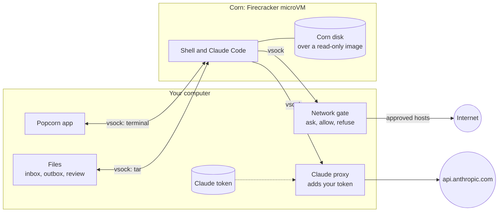
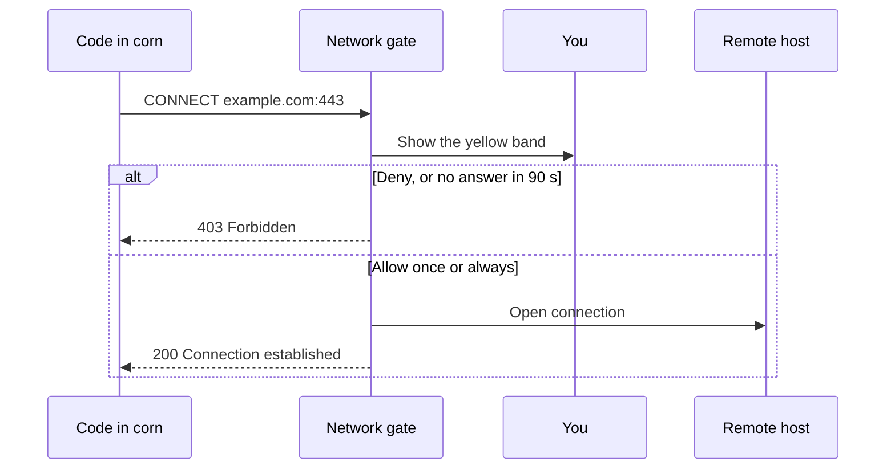

<p align="center">
  
</p>

<h1 align="center">Popcorn</h1>

<p align="center">
  A workbench for risky work.<br>
  Each job runs in a <b>corn</b>: a small virtual machine that cannot touch your computer.
</p>

---

## What it does

Popcorn is a desktop app for Linux. Use it for untrusted code, suspicious packages and unknown
binaries. You and Claude Code do the work in a corn. Your files, keys and network stay outside.

A corn is a [Firecracker](https://firecracker-microvm.github.io/) microVM. It has its own Linux
kernel. It starts in about one second. When you finish, you delete it.

- **Open a terminal** in a corn. Claude Code is ready inside.
- **Approve each connection.** A new host waits for your answer: deny, allow once or always allow.
- **Copy files in.** Drop files on the window, or select them.
- **Get results out.** Export files from `~/outbox`. They arrive as copies that cannot run.
- **Share a project folder.** The corn gets a copy. You approve each changed file before Popcorn writes it back.

## How it keeps you safe

| Guarantee | How |
|---|---|
| A corn has its own kernel | Each corn is a KVM virtual machine, not a container. A kernel exploit stays in the corn. |
| A corn has no network card | The only way out is vsock to Popcorn. There is no route to your network. |
| You approve each new host | The network gate holds each new connection until you answer. No answer in 90 s means no. |
| Your Claude token stays outside | Claude Code in the corn has a placeholder. Popcorn adds the real token on the way out. |
| A corn cannot see your files | Popcorn mounts no host folder. The corn sees a read-only image and its own disk. |
| Files come out only when you ask | Popcorn pulls files. A corn cannot push. Popcorn keeps only regular files and removes links, devices and unsafe paths. |
| Changes to your folder need your approval | Popcorn writes approved files only. It refuses paths that leave the folder or go through a link. |
| Secrets stay home | Popcorn refuses to share your home folder, or a folder with `.ssh`, `.gnupg`, `.aws` or `.config`. `.git` and ignored files stay out. |

### Limits

- A hypervisor escape is rare, but possible. Firecracker runs as your user, without its jailer.
- A host that you allow can receive data from the corn.
- Code in a corn can use your Claude quota. It cannot read your token.
- Malware can detect a virtual machine and hide. A quiet corn is not proof of safety.
- Keep your kernel and Firecracker up to date.

## Architecture



A new connection waits for you:



## Quick start

Popcorn runs on Linux with KVM. Read [docs/DEV.md](docs/DEV.md) for system packages.

```sh
./scripts/fetch-firecracker.sh   # Firecracker and a guest kernel, one time
./scripts/build-image.sh         # the workbench image, with Docker, one time
cargo run --release
```

Popcorn then asks for three items: your name, the image, and a Claude token (optional). Get a token with
`claude setup-token`.

## Documentation

- [docs/DEV.md](docs/DEV.md): stack, build, tests and workflow.
